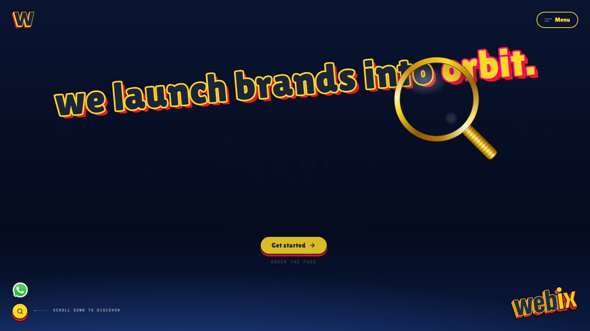
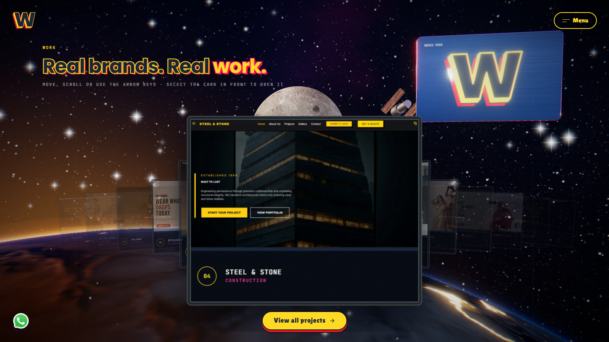
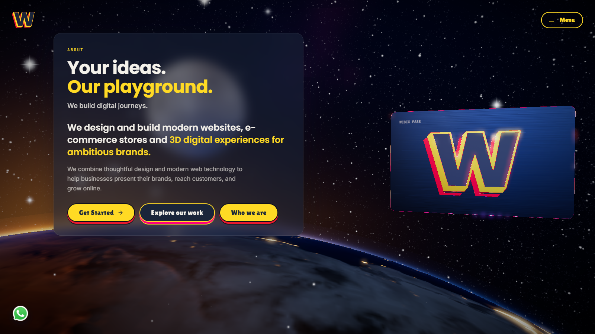
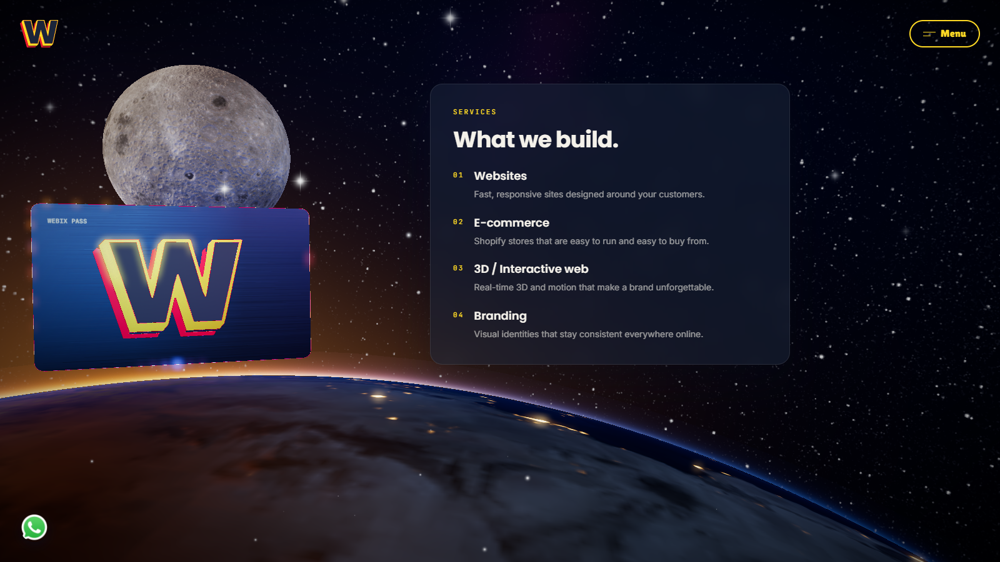
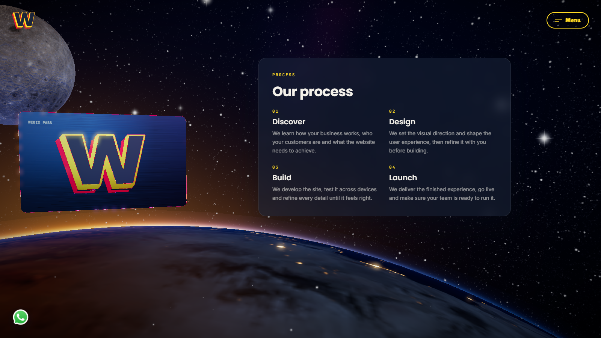
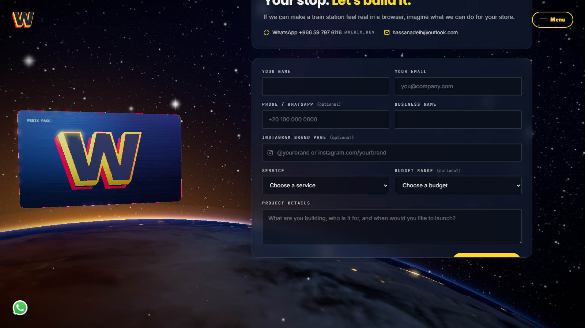
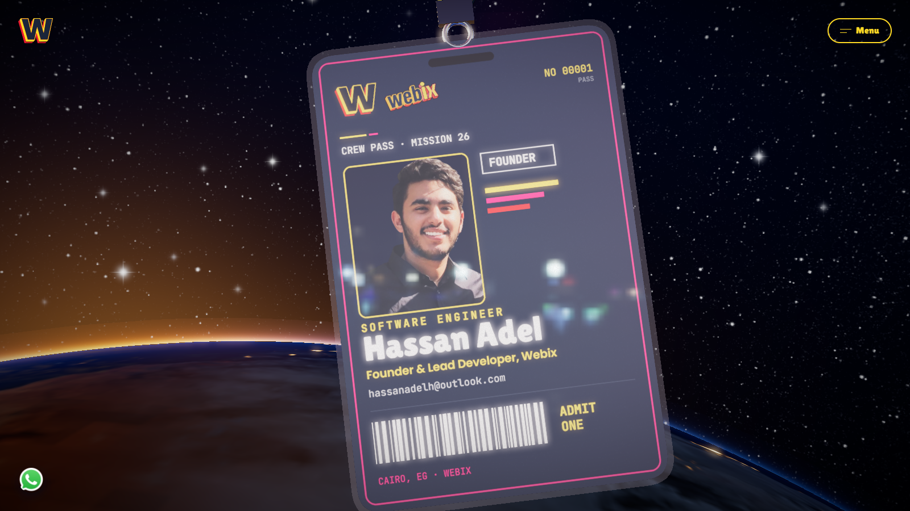
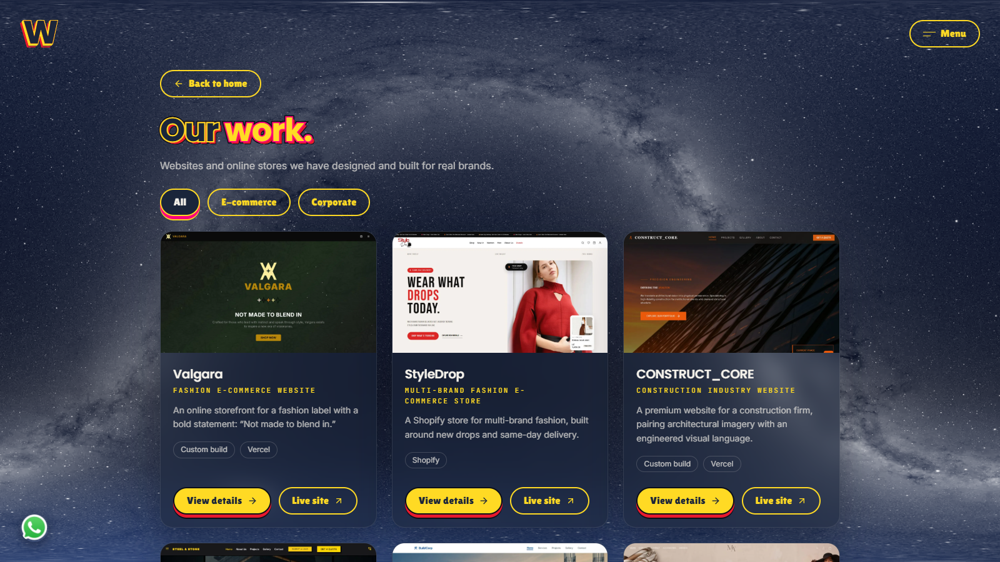
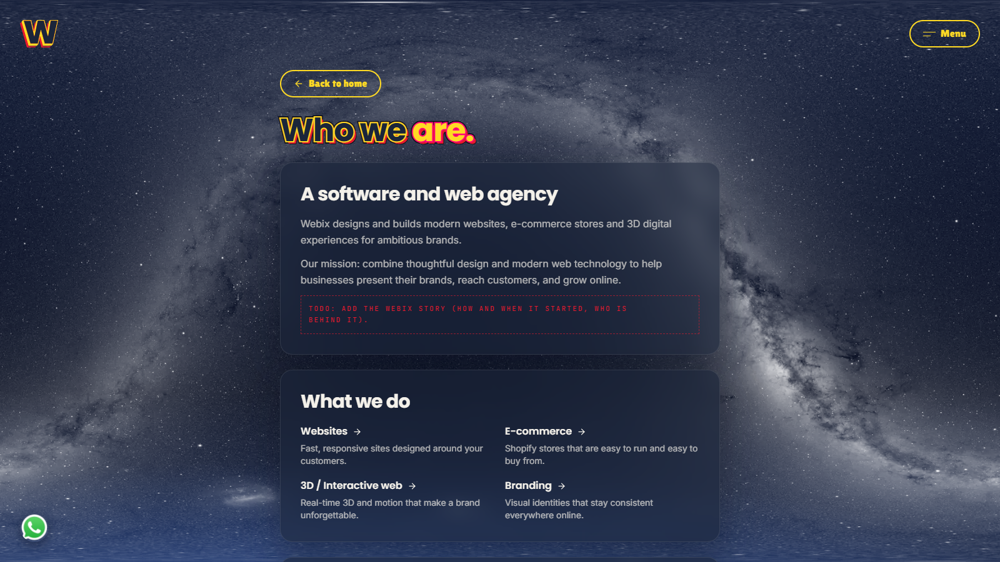
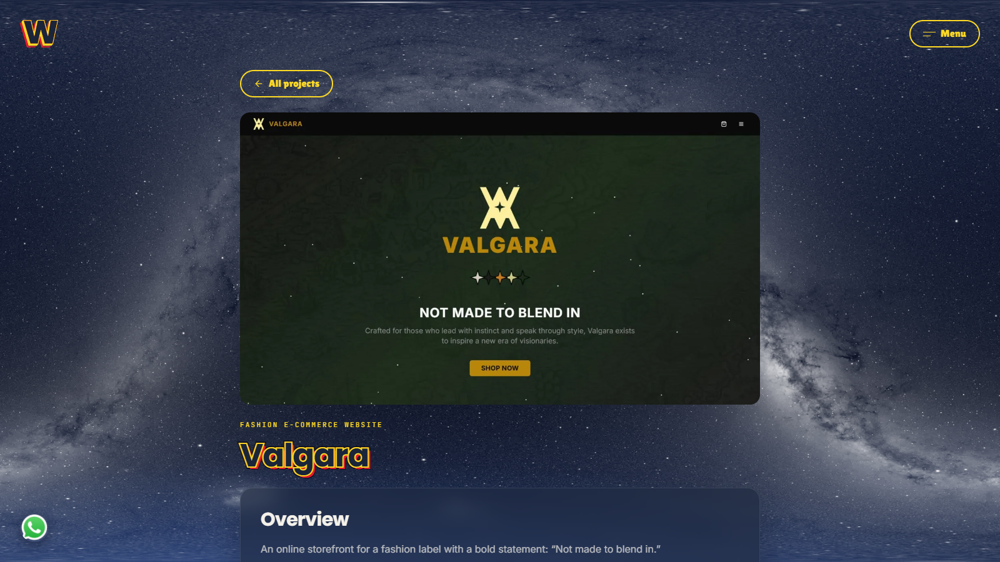

# Webix — minimal space site

Agency site for **Webix Software Solutions** (websites, Shopify e-commerce, 3D/interactive web, branding; Egyptian market).

**Concept:** photoreal space. The "Webix Pass" metal card (Webix W enamel inlay) floats above the Earth (Egypt, the Nile and the
Mediterranean at sunrise: day on the left, night with city lights on the right), the Moon slowly orbiting past behind it, Hubble
drifting far above, NASA's real star sky behind with a twinkling star layer. Hovering the card deals out the services. Calm, cinematic.

## Screenshots

| Hero | Work |
|---|---|
|  |  |

| About | Services |
|---|---|
|  |  |

| Process | Contact |
|---|---|
|  |  |

| About Me | Projects grid |
|---|---|
|  |  |

| Who we are | Project detail |
|---|---|
|  |  |

## Stack

- **TanStack Start** (React 19, SSR via Nitro), **Vite 8**, file-based routing (`src/routes/`).
- **Tailwind v4**, **shadcn/ui**.
- **three** 0.182.0, **@react-three/fiber** 9.8, **@react-three/drei** 10.7, **maath** (damping),
  **@react-three/postprocessing** 3.0.4 + **postprocessing** 6.39, **gsap** 3.13, **lenis** 1.3, **react-hook-form** + **zod**.
- Deployed as a fully static site — every route is prerendered at build time (`dist/client`); no server runtime required.
- Contact form via **Web3Forms** (client-side, no backend), with a honeypot spam trap.

## Pages

- `/` — the main journey: Hero → Work → About → Services → Process → Contact → About Me, one continuous scroll over a single
  fixed WebGL canvas.
- `/about-webix` — "Who we are" (CSS star sky, no 3D).
- `/projects` — filterable grid of all case studies.
- `/projects/:slug` — project detail (overview, what we did, tech, gallery + lightbox, prev/next).

## The scene

- One `<Canvas>` for the whole site: a procedurally lit Earth (NASA Blue Marble / Black Marble / GEBCO imagery) showing Egypt,
  the Nile and the Mediterranean at sunrise, with real day/night city lights; the Moon (CGI Moon Kit) orbiting the camera;
  Hubble (NASA 3D Resources) tumbling far above; a real NASA Deep Star Map behind a twinkling procedural star layer.
- The **Webix Pass**: a metal card with a traced-SVG "W" enamel inlay that never unmounts and follows the scroll with a single
  screen-anchored pose writer. Hovering/tapping it deals out four service cards from brand-colour slabs stacked behind it.
  A desktop-only magnifier lens lets visitors zoom into the Earth.
- Reduced-motion and phone/touch states are both first-class: animation intensity, star count, texture resolution and DPR all
  scale down automatically.

## Design tokens

- `--bg-night #070B14` background · `--indigo #1A253A` panels/card body · `--yellow #FFDA24` primary CTA/accents ·
  `--pink #FF007F` small accents · `--red #E81A2E` rare highlight · `--text #F4F1EA` warm white.
- Fonts: **Poppins** (headings), **Inter** (body), **JetBrains Mono** (small labels), **Lilita One** (hero headline only,
  self-hosted, OFL).
- Buttons: a single shared pill component (`src/components/site/Button.tsx`) used everywhere in the site.

## Local development

```bash
npm install
npm run dev          # http://localhost:5173
npm run build         # static build -> dist/client
npm run lint
npx tsc --noEmit -p . # type-check
```

Set `VITE_WEB3FORMS_KEY` in a `.env` file (see `.env.example`) for the contact form — it's read at build time, so hosting
needs it too.

## Hosting

Static hosting only — `dist/client` after `npm run build`. Recommended: **Cloudflare Pages** (Free tier, unlimited static
requests). Build command `npm run build`, output directory `dist/client`, env var `VITE_WEB3FORMS_KEY`.

## Credits

- Imagery: NASA. Earth: Blue Marble Next Generation (December, topography + bathymetry) and Black Marble 2016 (NASA Earth
  Observatory), clouds and GEBCO topography (NASA Visible Earth); textures, relief normal map and land mask built by
  `scripts/earth-textures.py` (KTX2 via Basis Universal `basisu`, Apache-2.0, not shipped; transcoder in `public/basis/` from three.js, MIT).
  Moon: CGI Moon Kit (NASA's Scientific Visualization Studio, LRO data). Sky: Deep Star Maps 2020 (NASA SVS).
  Satellite: Hubble Space Telescope model (NASA 3D Resources). Public domain; resized and converted to WebP in `public/space/`.
- Font: Lilita One by Juan Montoreano (SIL Open Font License, `public/fonts/OFL-LilitaOne.txt`).
- Card reflections: "Shanghai Bund" HDRI by Poly Haven, CC0.
